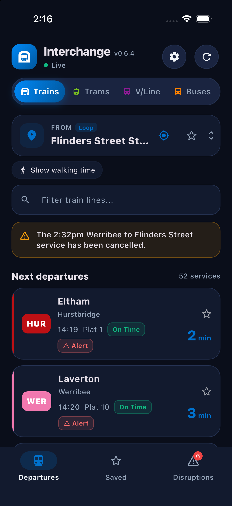
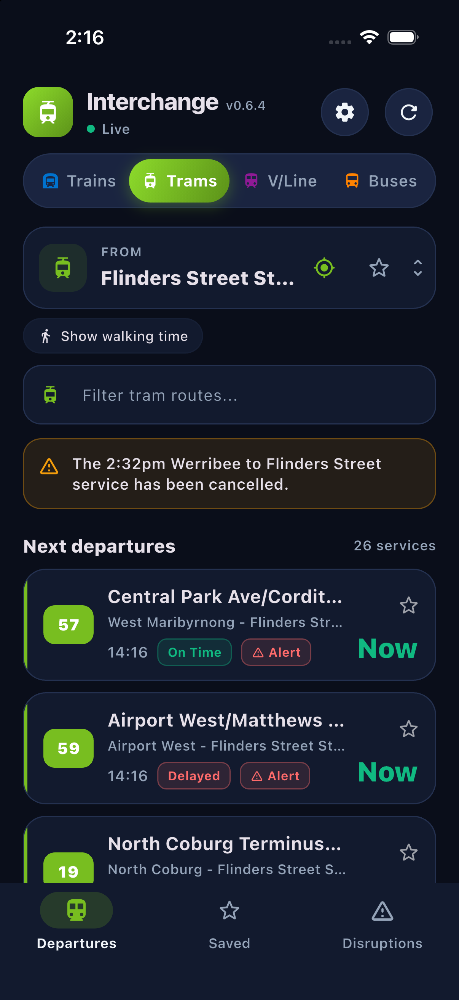
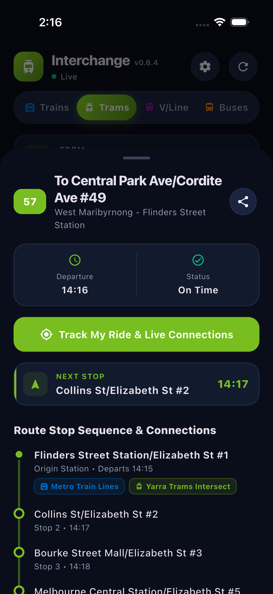
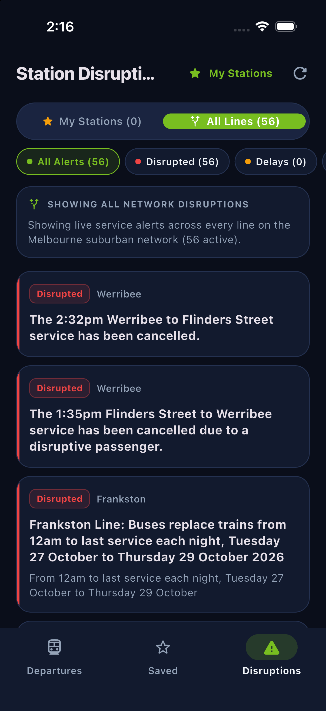
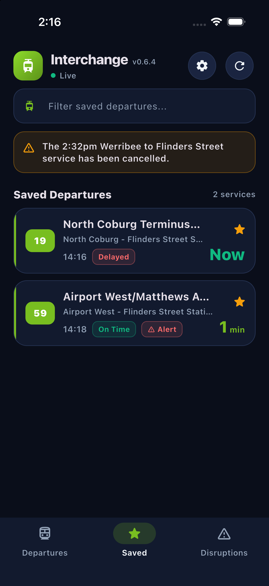

# Interchange

**Live Melbourne public transport, in one fast app.**

See when your next train, tram, V/Line or bus is actually leaving, follow your trip as it happens, and know whether you'll make your connection.

[**Download the latest release**](https://github.com/huh4k/Interchange/releases) · [Report an issue](https://github.com/huh4k/Interchange/issues)

 

&nbsp;

&nbsp;

---

## What it does

Open the app, pick a station, and see what's leaving next. That's it.

### One tap between networks

Switch between **Trains**, **Trams**, **V/Line** and **Buses** from the bar at the top. Each one has its own colour, so you always know which network you're looking at.

### Live departures

Every service shows its platform, whether it's **on time**, and a countdown ("Now", "4 min"). Times are live from Public Transport Victoria. If live data isn't available, the app falls back to the timetable and warns you that those times may not be accurate.

### Follow your trip

Tap a service to see every stop on its route with the time it gets there, and which stops connect to other trains or trams. Hit **Track My Ride** to follow along while you travel; the app tells you where you are, like "Between Richmond and Burnley".

### Know when to leave

Turn on **Show walking time** and each departure gets a "Leave by" time. Services you can't reach in time are dimmed, so you don't sprint for a train you'll miss.

### Connections

At key interchange stations, Interchange checks whether you'll make your transfer.

### Disruptions

The Disruptions tab shows live alerts for **My Stations** (the ones you've starred) or **All Lines**, and carries a badge when something's up. Cancellations also appear right on your departures screen.

### Save what you use

Star a departure to keep it on the **Saved** tab, and star a station to get its disruption alerts. Search is fast, and the app remembers your recent stations. Tap the location button to find the nearest stop with GPS.

### Buses too

Find any metro bus stop by searching or by GPS. Every service has a route badge, and bus stations show which bay to go to.

## Get the app

1. Go to the **[Releases page](https://github.com/huh4k/Interchange/releases)**.
2. Download the latest build for your device.
3. Install it and open Interchange.

Each release lists what's changed since the last one.

## Good to know

- **Location is optional.** It's only used to find stops near you and to work out walking time.
- **Buses and offline timetables.** The bus timetable is a large download (about 50 MB). On phones and desktop, the app asks before downloading it. Choose **Live only** to skip it and use live data alone. The web version never downloads it.
- **Live data comes from PTV.** If PTV is having a bad day, the app tells you when it's showing timetable times instead.

## Questions and problems

Found a bug, or want a feature? [Open an issue](https://github.com/huh4k/Interchange/issues).

## For developers

Want to run it from source or help out? See the [development guide](docs/DEVELOPMENT.md).

## License

Released under the [GNU General Public License v3.0](LICENSE).
